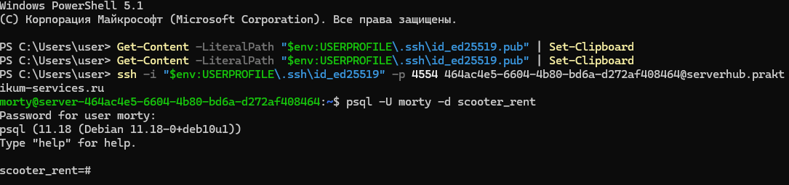

# Яндекс Самокат — автотест API

Тест создаёт заказ через API, сохраняет его трек-номер и проверяет, что запрос на получение заказа по этому номеру возвращает HTTP 200.

Используются Python, pytest и requests.

## Запуск в PowerShell

Укажи адрес запущенного учебного стенда в `configuration.py`, в переменной `URL_SERVICE`. Из папки проекта выполни:

```powershell
python -m venv .venv
.\.venv\Scripts\python.exe -m pip install pytest requests
.\.venv\Scripts\python.exe -m pytest -v get_order_by_track_test.py
```

## Результат запуска

